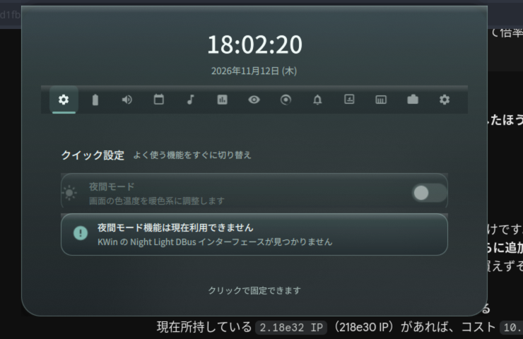
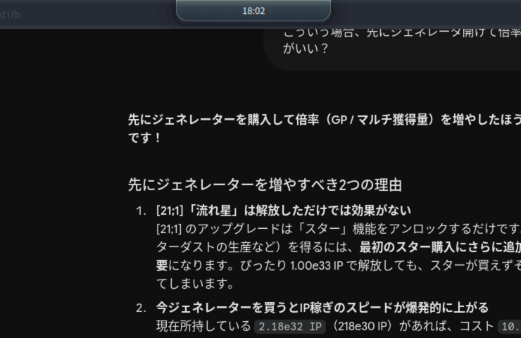

# ActiveNotch

KDE Plasma 6 (Wayland / KWin) に最適化した、画面上部中央に張り付く **Dynamic Island 風の多機能ノッチ**。
Qt6 (QML) + LayerShellQt による単体常駐アプリで、日本語 UI を標準対応しています。

- ホバーで展開 / クリックで固定 / `Esc` で解除
- 時計・カレンダー・バッテリー・音量・輝度・メディア・システム統計
- Wi-Fi / Bluetooth / 天気 / 通知センター / クリップボード履歴
- アプリランチャー / システムトレイ (SNI) / クイック設定
- くすみ Frutiger Aero テーマ + KWin の frosted glass (ブラー)
- 全画面アプリ表示中は自動退避、外側クリックは背後のウィンドウへ透過




設計の詳細は [PLAN.md](PLAN.md)、実装契約は [docs/CONTRACT.md](docs/CONTRACT.md) を参照してください。

---

## 動作環境

| 項目 | 要件 |
|---|---|
| デスクトップ | KDE Plasma 6 / KWin 6 (Wayland セッション) |
| ディストリビューション | Arch Linux / EndeavourOS など (Debian・Fedora 系も可) |
| Qt | 6.5 以上 (開発・検証は 6.12) |
| GPU | ベンダー不問 (Intel Arc で検証) |

> **Wayland 専用です。** layer-shell と `ext_background_effect_v1` を使うため、
> X11 セッションでは正しく表示されません。

---

## インストール

### ワンコマンド (推奨)

```sh
git clone https://github.com/yukirawa/Active_Notch.git
cd Active_Notch
./install.sh
```

`install.sh` は以下を自動で行います。

1. ディストリビューションを判定してビルド依存を導入
2. CMake で Release ビルド
3. バイナリ / デスクトップエントリ / systemd `--user` ユニット / アイコンを配置
4. systemd `--user` で有効化
5. 輝度権限・任意依存の案内を表示

導入先は root なら `/usr/local`、一般ユーザーなら `~/.local` です。

```sh
./install.sh --user       # ~/.local に導入 (sudo 不要)
./install.sh --system     # /usr/local に導入 (sudo を使用)
./install.sh --autostart  # systemd ではなく XDG 自動起動を使う
./install.sh --no-deps    # 依存導入をスキップ
./install.sh --no-service # 自動起動の有効化をスキップ
./install.sh --help       # 全オプション
```

### 手動ビルド

```sh
cmake -S . -B build -G Ninja -DCMAKE_BUILD_TYPE=Release
cmake --build build
./build/activenotch
```

システムへ配置する場合:

```sh
sudo cmake --install build --prefix /usr/local
# または
cmake --install build --prefix "$HOME/.local"
```

### Arch Linux / AUR

`packaging/PKGBUILD` を用意しています。リリースタグ `v1.0.0` のソースからビルドします。

```sh
cd packaging
makepkg -si
```

インストール後、自動起動を有効化してください。

```sh
systemctl --user daemon-reload
systemctl --user enable --now activenotch.service
```

### アンインストール

```sh
./uninstall.sh              # 導入先を自動判定
./uninstall.sh --user       # ~/.local から削除
./uninstall.sh --system     # /usr/local から削除
./uninstall.sh --purge      # 設定ファイルも削除
```

---

## 使い方

| 操作 | 動作 |
|---|---|
| ノッチにホバー | 展開 |
| ノッチをクリック | 固定 (ピン留め) |
| 固定中にもう一度クリック / `Esc` / 外側クリック | 固定解除 |
| 全画面アプリを前面に出す | ノッチが自動退避 |
| ノッチ外をクリック | 背後のウィンドウへ透過 (入力マスク外) |

展開パネル内のタブから各機能へアクセスできます。
タブの表示・並びは `~/.config/activenotch/activenotchrc` の `EnabledPages` で変更できます。

### 設定

アプリ内の **Settings** タブ、または設定ファイルを直接編集します。

- 設定ファイル: `~/.config/activenotch/activenotchrc` (KConfig 形式)
- 変更は Settings タブで保存すると即時反映されます (言語は再翻訳、間隔はタイマー更新)

```ini
[General]
Language=ja                 ; ja | en
Anchor=top                  ; top | top-left | top-right
AutoHideFullscreen=true

[Geometry]
CollapsedWidth=220
CollapsedHeight=30
ExpandedWidth=660
ExpandedHeight=440
CornerRadiusCollapsed=16
CornerRadiusExpanded=28

[Theme]
AccentColor=#7FB8B0
Opacity=0.72
BlurEnabled=true

[Behavior]
Dnd=false
EnabledPages=media,stats,battery,sound,calendar,notifications,network,weather,quick,clipboard,launcher,tray
WeatherLocation=auto        ; auto | 緯度,経度
WeatherUnit=metric          ; metric | imperial
OwnDaemon=true              ; 通知デーモンを自前で運用
DoNotDisturb=false
MaxHistory=100

[Intervals]
StatsInterval=1000          ; ms
BatteryInterval=30000
WeatherInterval=900000
```

設定を初期化するには設定ファイルを削除して再起動するか、Settings タブのリセットを使ってください。

---

## テスト

### 自動テスト

```sh
# configure + build (警告は表示のみ、コンパイルエラーは非ゼロ exit)
./scripts/dev.sh

# QtTest 単体テスト (ctest) — 16 スイート
./scripts/run-tests.sh

# 自動視覚検証: ビルド → 起動 → 配置/サイズ/描画/透過を検証
./scripts/verify-ui.sh
```

`verify-ui.sh` は以下を検証し、PASS/FAIL 表を出力します。

- (a) 入力領域マスク (ピル) の中心が配置先出力の水平中央 (±2px)
- (b) マスクサイズが折りたたみピル相当 (220x30 論理px)
- (c) ノッチが描画され、外側が完全透過 (自ウィンドウ grab の alpha で判定)
- (d) 入力マスクがピル領域のみ (外側クリック透過)
- (e) マスクが配置先出力内に収まる

成果物 (スクリーンショット / grab / stdout / stderr) は `scripts/artifacts/` に保存されます。
壁紙がアニメーションする環境でも安定するよう、色差分ではなく **論理座標の幾何検証 + 自ウィンドウ grab**
で判定します。

### 手動テスト

```sh
./scripts/run.sh    # Wayland チェック → 必要ならビルド → 起動
./scripts/stop.sh   # 稼働中インスタンスを停止 (未起動でも成功)
```

### デバッグ用環境変数

```sh
ACTIVENOTCH_PRINT_GEOMETRY=1 ./build/activenotch
# → 表示時・ジオメトリ変更時に stdout へ出力 (論理px)
#   GEOMETRY x=<x> y=<y> w=<w> h=<h> scale=<DPR> screen=<画面名>
#   MASK x=<x> y=<y> w=<w> h=<h>

ACTIVENOTCH_GRAB=/tmp/notch.png ./build/activenotch
# → 1.5 秒後に自ウィンドウを alpha 付き PNG で保存し GRAB 行を出力

ACTIVENOTCH_START_EXPANDED=1 ./build/activenotch
# → 起動直後に展開状態へ遷移 (スクリーンショット撮影用)
```

---

## 依存関係

### ビルド依存

| 依存 | 用途 |
|---|---|
| Qt6 (Base / Declarative / Wayland / Svg) | アプリ本体 (Quick + Qml) |
| `layer-shell-qt` | wlr-layer-shell による配置 (KWin 対応) |
| KF6 (Config / CalendarCore / Holidays / BluezQt / Service / I18n) | 設定・祝日・Bluetooth・ランチャー・翻訳 |
| `wayland-client` | `ext_background_effect_v1` の直接バインド |
| CMake ≥ 3.25 / Ninja / GCC (C++20) / pkgconf | ビルド |

**注意 (確認済み)**: `extra-cmake-modules` (ECM) は不要です。
LayerShellQt の CMakeConfig は `Qt6Gui` にのみ `find_dependency` するため、
ECM を入れなくても `find_package(LayerShellQt REQUIRED)` が通ります
(実機: layer-shell-qt 6.8.2-1 / Qt 6.12.0 で確認)。

### 任意依存 (無くても起動します)

| 依存 | 無い場合 |
|---|---|
| `wpctl` (PipeWire / WirePlumber) | 音量の表示・操作が無効 |
| NetworkManager | Wi-Fi / 有線の表示・接続が無効 |
| BlueZ | Bluetooth の表示・接続が無効 |
| `wl-clipboard` (`wl-paste` / `wl-copy`) | クリップボード履歴が無効 (`available=false`) |
| KWin スクリプト有効 | 全画面アプリ検出が無効 (退避しない) |

---

## トラブルシュート

### ノッチが表示されない

1. Wayland セッションか確認します。
   ```sh
   echo "$WAYLAND_DISPLAY"   # wayland-1 などが表示されること
   ```
2. ログを確認します。
   ```sh
   journalctl --user -u activenotch -f
   # 手動起動の場合
   QT_FORCE_STDERR_LOGGING=1 ./build/activenotch
   ```
3. 既に別インスタンスが動いていないか確認します。ActiveNotch は D-Bus 名
   `dev.yukirawa.activenotch` で二重起動を防ぎます。
   ```sh
   pkill -x activenotch
   systemctl --user restart activenotch
   ```

### ブラー (frosted glass) が効かない

KWin のブラーが有効になっている必要があります。
システム設定 → デスクトップエフェクト → 「ぼかし」を有効にしてください。
未対応環境では半透明表示に自動フォールバックします (クラッシュしません)。

### 輝度スライダーが動かない

BrightnessService は logind (`Session.SetBrightness`) を優先し、失敗時は
`/sys/class/backlight/*/brightness` へ直接書き込みます。直接書き込みには権限が必要です。

```sh
sudo usermod -aG video "$USER"   # 再ログインが必要
```

それでも失敗する場合は udev ルールを追加してください。

```sh
# /etc/udev/rules.d/90-backlight.rules
ACTION=="add", SUBSYSTEM=="backlight", RUN+="/bin/chgrp video /sys/class/backlight/%k/brightness", RUN+="/bin/chmod g+w /sys/class/backlight/%k/brightness"
```

### 通知が表示されない / 通知履歴が空

通知センターは `org.freedesktop.Notifications` を自前で取得します。
Plasma の通知デーモンなどが既に所有している場合、`ownsDaemon=false` となり
履歴機能は無効になります (既存デーモンは停止しません)。
設定の `OwnDaemon=false` でミラーモードに切り替えられます。

### クリップボード履歴が空

`wl-clipboard` が必要です。

```sh
sudo pacman -S wl-clipboard        # Arch
sudo apt install wl-clipboard      # Debian/Ubuntu
```

### トレイにアイコンが出ない

`org.kde.StatusNotifierWatcher` が必要です。Plasma のシステムトレイが動作している
セッションで起動してください。取得に失敗しても他の機能は動作します。

### 全画面アプリで退避しない

KWin スクリプトが無効になっている可能性があります。
システム設定 → ウィンドウ管理 → KWin スクリプト を確認してください。
起動時に `activenotchfs` スクリプトを自動ロードします。

### 設定を初期化したい

```sh
rm -rf ~/.config/activenotch
systemctl --user restart activenotch
```

---

## 技術メモ

- LayerShellQt の CMake リンクターゲットは `LayerShellQt::Interface`
  (`LayerShellQt::LayerShellQt` ではない)
- QML モジュール URI: `dev.yukirawa.activenotch` (VERSION 1.0)
- `Shell::useLayerShell()` は Qt 6.5 以降不要・非推奨のため呼んでいない
  (QWindow に LayerShellQt::Window を紐付けると Wayland QPA が自動選択する)
- ウィンドウは 660x448 論理px 固定。layer-shell のリサイズはジャンクの原因になるため、
  開閉アニメは QML 内部のみで行い、入力マスク (`setMask`) だけを更新する
- 入力マスクは **論理px** で渡す (DPR 倍しない)
- ブラーは KWin 6.8 が `org_kde_kwin_blur` を広告しないため、
  `ext_background_effect_v1` を libwayland-client で直接バインドしている
- 全画面検出は KWin スクリプト + D-Bus `dev.yukirawa.activenotch`。
  `/Scripting` の引数なし `start()` が正 (個別スクリプトの `run()` ではない)
- アイコンは Qt 6.12 の `data:` URL 不具合を避けるため、
  `image://svg/<percent-encoded-svg>` の独自プロバイダを使用
- `QDBusArgument` の読み取りは必ず `const` で行う
  (非 const だと書き込み用 overload が選ばれ SIGABRT する)

---

## ライセンス

GPL-3.0-or-later。詳細は [LICENSE](LICENSE) を参照してください。
